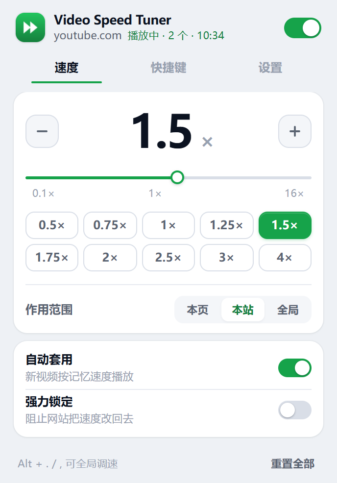
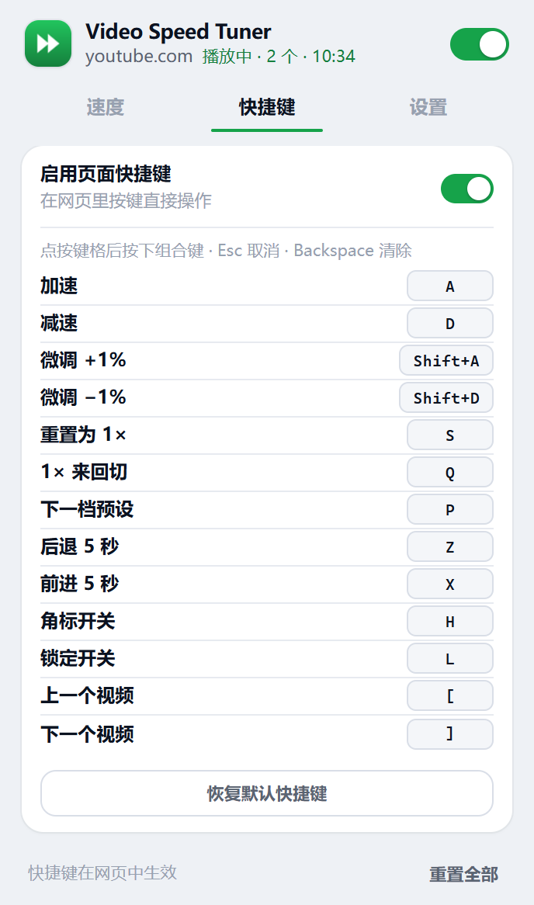
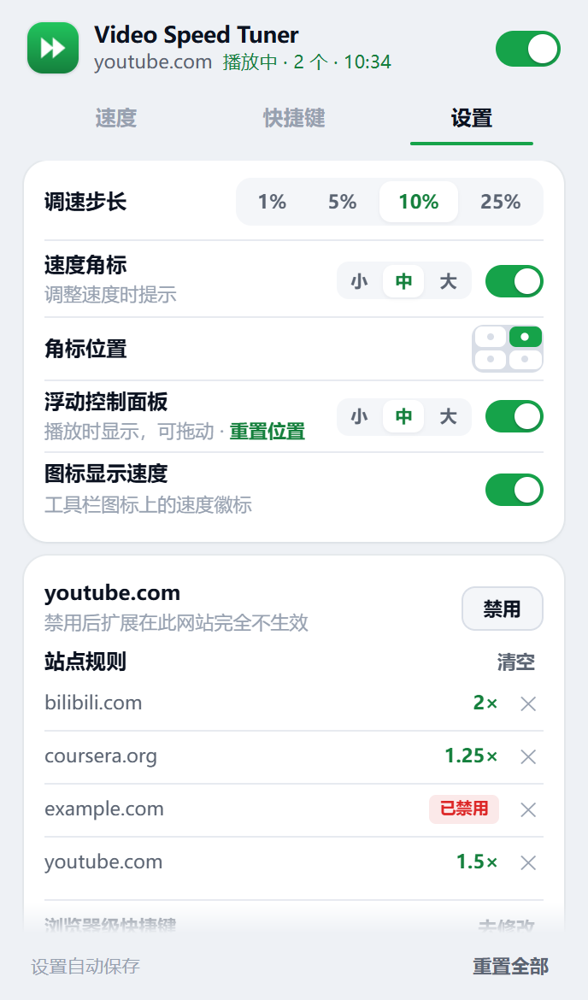

<p align="center">
  
</p>

<p align="center">
  <a href="README.md">中文</a> · <b>English</b>
</p>

<p align="center">
  
  
  
</p>

<p align="center">
  
  
  
</p>

<p align="center">
  Set any web video to the speed you actually want.<br>
  <sub>0.1× – 16× with 1% precision. No account, no network, works the moment you install it.</sub>
</p>

---

## What it is

A browser extension that controls playback speed of HTML5 video on any page.

It is not tied to a specific site — YouTube, Bilibili, Coursera, meeting replays, podcast pages. Anywhere the page uses a native `<video>` / `<audio>` element, it works. Speed changes go through the standard `playbackRate` property, so **pitch is preserved** — human voices don't turn into robots.

Most extensions in this space are missing three things, which this one adds: **per-site speed memory**, **13 rebindable shortcuts**, and **per-site exclusion** (switch it off on sites you don't want it touching).

Fully independent implementation, ~107 KB, no third-party dependencies, no remote code.

---

## Screenshots

<p align="center">
  
  
  
</p>

---

## Features

**Speed control**

- 0.1× to 16×, minimum step 1%
- Logarithmic slider — fine control at low speeds, quick reach at high speeds
- 10 one-click presets
- Adjustable step: 1% / 5% / 10% / 25%

**Memory and scope**

- Remembers speed per site and restores it automatically
- Three scopes: this tab / this site / global
- "Force lock" puts the speed back when a site resets it

**Shortcuts**

- 13 actions, all rebindable, with live conflict detection
- Browser-level shortcuts (`Alt + .` / `Alt + ,` / `Alt + 0`) that don't occupy page keys

**On-page controls**

- Floating panel: draggable, resizable, shows which player you're controlling
- Speed badge: four corner positions, three sizes
- Separate control per player on multi-video pages

**Site exclusion**

- One click to disable on the current site — the extension goes completely silent there
- Subdomain aware (blocking `youtube.com` also covers `music.youtube.com`)

---

## Install

```bash
git clone https://github.com/cv-superding/video-speed-tuner.git
```

1. Open `edge://extensions/` (`chrome://extensions/` for Chrome)
2. Enable **Developer mode**
3. Click **Load unpacked** and select the repo root (the folder directly containing `manifest.json`)
4. Pin **Video Speed Tuner** from the toolbar extensions menu

> You may see a "disable developer mode extensions" notice on each launch. Just dismiss it — it applies to every unpacked extension.

**Error `Cannot load extension with file or directory name _xxx`?**
Chromium reserves the `_` prefix. Remove or rename that entry.

**Error `Manifest file is missing or unreadable`?**
Wrong folder level — select the one that **directly contains `manifest.json`**.

Requirements: Edge 88+ / Chrome 88+ (Manifest V3), nothing else.

---

## Shortcuts

| Action | Default | Notes |
|---|:---:|---|
| Faster | `A` | One step (10% by default) |
| Slower | `D` | One step |
| Fine +1% | `Shift` + `A` | |
| Fine −1% | `Shift` + `D` | |
| Reset to 1× | `S` | Permanent; rewrites stored speed |
| Toggle 1× | `Q` | Back to 1×, press again to return |
| Next preset | `P` | Cycles 0.25 → 0.5 → … → 8 |
| Back 5s | `Z` | |
| Forward 5s | `X` | |
| Toggle badge | `H` | |
| Toggle lock | `L` | |
| Previous video | `[` | Cycles control target |
| Next video | `]` | |

Browser-level shortcuts are managed by Chromium and cannot be rebound by the extension. Change them at `edge://extensions/shortcuts`.

**`S` vs `Q`**: `S` is permanent (goes to 1× and overwrites the stored speed); `Q` is temporary (affects the current page only, leaves site memory untouched).

---

## Speed priority

```
Tab override  >  Site memory  >  Global default
```

The scope selector decides which layer a change is written to. Choosing "this site" also clears the tab override so the change takes effect immediately.

---

## Site exclusion

Some sites fight with the extension — either their player manages speed itself, or your keystrokes collide with their shortcuts. In **Settings → Site rules**, one click disables it:

- The extension goes completely silent there: no speed changes, no panel, no shortcuts (including browser-level ones), badge cleared
- On entering a blocked site it restores 1× once, then stops interfering
- Subdomain aware
- The list merges "remembered speed" and "blocked" so each site's policy is visible at a glance

---

## Privacy

**Nothing is collected.**

- No server, no analytics, no crash reporting, no network requests
- All settings live in the browser's local `chrome.storage.local`
- No reading of page text, forms, cookies, or personal data — it only locates media elements and sets their playback rate

Permissions: `storage` (settings), `contextMenus` (right-click speed menu), plus `host_permissions: <all_urls>` which is unavoidable for finding `<video>` on arbitrary sites.

---

## Implementation notes

```
manifest.json      Manifest V3
background.js      Service worker: single source of truth, badge, browser shortcuts, context menu
content.js         Injected into all frames: media control, floating panel, page shortcuts, badge
popup.html/css/js  Popup: speed / shortcuts / settings
icons/             16/32/48/128, including grayscale disabled variants
```

A few deliberate choices:

- **Settings have a single source of truth in the background worker.** Content scripts never read storage directly; they receive `state` broadcasts on `chrome.storage.onChanged`, which prevents drift across tabs.
- **The 1× toggle persists with `scope: 'tab'`.** Otherwise a temporary flip to 1× would overwrite site memory and make that site permanently slow.
- **Site exclusion restores speed only on state transition.** Re-applying 1× on every broadcast would clobber manual adjustments on a blocked site.
- **Transitions always name explicit properties**, never `all`; motion uses a single `cubic-bezier(0.23, 1, 0.32, 1)` curve.
- **Full `prefers-reduced-motion` fallback.**

Test suite covers 38 cases (Edge headless + Puppeteer): speed pipeline, all 13 shortcuts, site exclusion, sizing/positioning, key rebinding and conflict detection.

---

## Known limitations

- Page shortcuts only fire when the page has focus and the focus is not in an input field (intentional — otherwise typing would be eaten)
- Combinations reserved by the browser (`Ctrl+W`, `Ctrl+T`) cannot be recorded
- The floating panel only renders in the top-level page; iframe players are controlled via popup and shortcuts
- Video rendered via `<canvas>` or DRM (e.g. Netflix) does not go through `playbackRate` and cannot be controlled

---

## License

[MIT](LICENSE) © 2026 cv-superding
