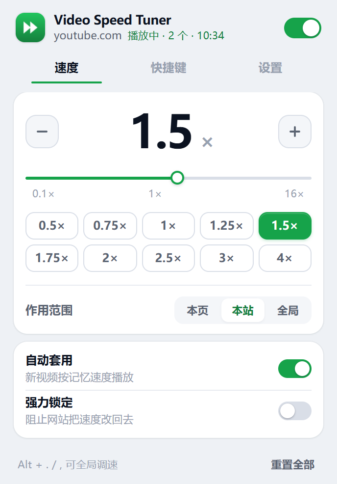
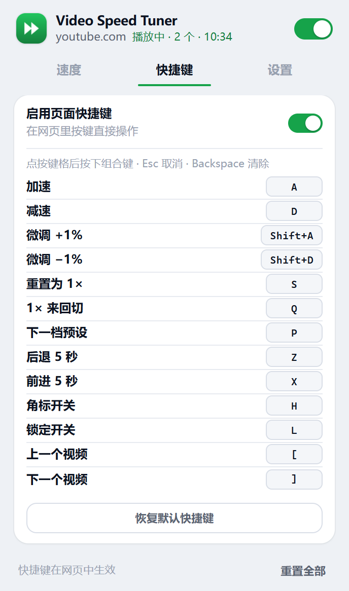
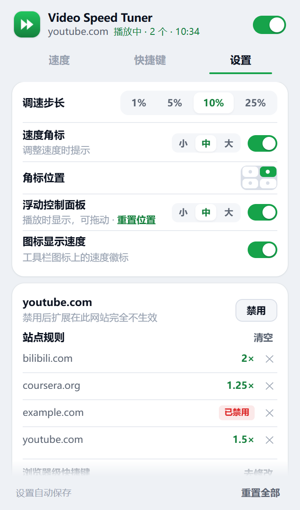

<p align="center">
  
</p>

<p align="center">
  <b>中文</b> · <a href="README.en.md">English</a>
</p>

<p align="center">
  
  
  
</p>

<p align="center">
  
  
  
</p>

<p align="center">
  把任何网页的视频，调到你要的速度。<br>
  <sub>0.1× – 16×，1% 精度。装上就能用，不需要账号，不联网。</sub>
</p>

---

## 这是什么

一个浏览器扩展，用来控制网页里 HTML5 视频的播放速度。

它不绑定特定网站——YouTube、B 站、慕课、会议回放、播客网页版，只要页面用的是原生 `<video>` / `<audio>`，就归它管。调速走的是标准的 `playbackRate` 属性，所以**变速不变调**，人声不会变成机器人。

市面上的同类扩展不少，这个版本主要补了三件常见缺失：**按站点记住速度**、**13 个全部可改键的快捷键**、**站点排除**（不想被管的网站一键关掉）。

代码完全独立实现，约 107 KB，无第三方依赖，无远程加载。

---

## 截图

<p align="center">
  
  
  
</p>

<p align="center">
  <sub>速度调节 · 快捷键改绑 · 站点规则与显示设置</sub>
</p>

---

## 功能

**调速**

- 0.1× 到 16×，最小步进 1%
- 对数滑块，低速区间给足精度，高速区间不费劲
- 10 个预设档一键切换
- 步长可选 1% / 5% / 10% / 25%

**记忆与作用域**

- 按站点记住速度，下次访问自动恢复
- 三种作用域：本页 / 本站 / 全局
- 网站把速度改回去时，「强力锁定」会帮你补回

**快捷键**

- 13 个动作，全部可改绑，组合冲突实时检测
- 浏览器级快捷键（`Alt + .` / `Alt + ,` / `Alt + 0`）不占用页面按键

**页面内控制**

- 浮动面板：可拖动、可缩放、显示当前控制第几个播放器
- 速度角标：四角定位、三档大小
- 多视频页面支持单播放器独立控制

**站点排除**

- 一键禁用当前网站，扩展在那里完全不工作
- 支持子域（禁用 `youtube.com` 覆盖 `music.youtube.com`）

---

## 安装

### 从源码加载（推荐，可随时改）

```bash
git clone https://github.com/cv-superding/video-speed-tuner.git
```

1. 打开 `edge://extensions/`（Chrome 用 `chrome://extensions/`）
2. 打开 **开发人员模式**
3. 点 **加载解压缩的扩展**，选中仓库根目录（直接包含 `manifest.json` 的那一层）
4. 在工具栏拼图图标里把 **Video Speed Tuner** 固定出来

> 每次启动可能出现「请停用以开发者模式运行的扩展程序」提示，点 × 关闭即可。这是所有解包扩展的通用提示。

**加载报错 `Cannot load extension with file or directory name _xxx`？**
Chromium 把 `_` 开头的条目当作系统保留名。删掉或移走它。

**加载报错 `Manifest file is missing or unreadable`？**
选中的目录层级不对——要选**直接包含 `manifest.json`** 的那一层。

### 环境要求

- Edge 88+ / Chrome 88+（Manifest V3）
- 无其他依赖

---

## 快捷键

默认键位数对齐了同类工具的常见习惯：`A` 加速、`D` 减速、`S` 重置。

| 动作 | 默认键 | 说明 |
|---|:---:|---|
| 加速 | `A` | 加一个步长（默认 10%） |
| 减速 | `D` | 减一个步长 |
| 微调 +1% | `Shift` + `A` | 精确到 1% |
| 微调 −1% | `Shift` + `D` | 精确到 1% |
| 重置为 1× | `S` | 永久回到 1× |
| 1× 来回切 | `Q` | 按一下回 1×，再按一下回到切换前的速度 |
| 下一档预设 | `P` | 0.25 → 0.5 → … → 8 循环 |
| 后退 5 秒 | `Z` | |
| 前进 5 秒 | `X` | |
| 角标开关 | `H` | |
| 锁定开关 | `L` | |
| 上一个视频 | `[` | 多播放器页面切换控制目标 |
| 下一个视频 | `]` | |

浏览器级快捷键由 Chromium 管理，扩展不能自己改：

| 动作 | 默认键 |
|---|:---:|
| 加速 | `Alt` + `.` |
| 减速 | `Alt` + `,` |
| 重置 | `Alt` + `0` |

要改的话，在面板「设置 → 浏览器级快捷键」点「去修改」，跳转 `edge://extensions/shortcuts`。

**`S` 和 `Q` 的区别**：`S` 是归属操作（永久回 1×，会改写记忆速度）；`Q` 是临时切换（只影响当前页面，不动站点记忆）。

---

## 速度优先级

```
本页临时速度  >  本站记忆速度  >  全局默认速度
```

改速度时按「作用范围」决定存到哪一层。选「本站」会自动清掉本页的临时覆盖，保证当前页立刻生效。

---

## 站点排除

有些网站不希望扩展介入（播放器自己管速度，或者按键会打架）。在「设置 → 站点规则」里一键禁用：

- 该站点上扩展**完全不工作**：不调速、不显示面板、不响应快捷键（含浏览器级）、徽标清空
- 进入被禁用的站点时，会先把速度还回 1× 再停手，之后不再干涉你手动调整
- 支持子域匹配
- 列表把「记住的速度」和「已禁用」合并显示，一眼看清每个站点的处理方式

---

## 浮动面板

视频开始播放时，页面右下角出现一个小面板：

- 中间大数字是当前速度，`−` / `+` 按步长调节
- 底部进度条可直接点/拖到任意速度
- 按住空白处可拖动，位置会记住
- 右侧 `2/3` 表示当前控制第几个播放器，`✕` 隐藏本页面板
- 暂停 4 秒后自动淡出

角标与面板的位置、大小都能在设置里调（四角定位 / 三档缩放）。

---

## 隐私

**不收集任何数据。**

- 无服务器、无分析 SDK、无崩溃上报、无网络请求
- 所有设置存在浏览器本地的 `chrome.storage.local`
- 不读取页面文本、表单、Cookie 或任何个人信息，只查找媒体元素并设置其播放速率

权限只有两项：

| 权限 | 用途 |
|---|---|
| `storage` | 保存速度设置与快捷键绑定 |
| `contextMenus` | 在视频上右键提供调速菜单 |

加上 `host_permissions: <all_urls>`——这是「在任意网站找 `<video>` 并改 `playbackRate`」的必要条件，无法用更窄的范围替代。

---

## 技术说明

```
manifest.json     扩展清单（MV3）
background.js     service worker：设置唯一真源、徽标、浏览器级快捷键、右键菜单
content.js        注入所有 frame：媒体元素控制、浮动面板、页面快捷键、角标
popup.html/css/js  弹出面板：速度 / 快捷键 / 设置
icons/             16/32/48/128，含禁用态灰色版
```

设计上几个刻意的选择：

- **设置唯一真源在 background**。content script 不直接读 storage，靠 `chrome.storage.onChanged` 广播 `state` 消息，避免多标签页状态漂移。
- **1× 切换落库用 `scope: 'tab'`**。否则临时切一下 1×，站点记忆就被写成 1×，下次访问永久变慢速。
- **站点排除只在状态切换时恢复一次速度**。每次广播都设 1× 会冲掉用户在被禁用站点的手动调整。
- **`transition` 全部指定具体属性**，不用 `all`；动效统一走 `cubic-bezier(0.23, 1, 0.32, 1)`。
- **完整的 `prefers-reduced-motion` 降级**。

测试覆盖 38 个用例（Edge headless + Puppeteer），涵盖速度链路、13 个快捷键、站点排除、缩放定位、快捷键改绑与冲突检测。

---

## 已知限制

- 页面快捷键只在网页有焦点、且焦点不在输入框时触发（刻意为之，否则打字会被吃掉）
- 被浏览器占用的组合（`Ctrl+W`、`Ctrl+T`）录制不到，换个组合即可
- 浮动面板只显示在顶层页面；iframe 内嵌播放器通过 popup 和快捷键控制
- 使用 `<canvas>` 或 DRM（如 Netflix）播放的视频不走 `playbackRate`，无法调速

---

## License

[MIT](LICENSE) © 2026 cv-superding
